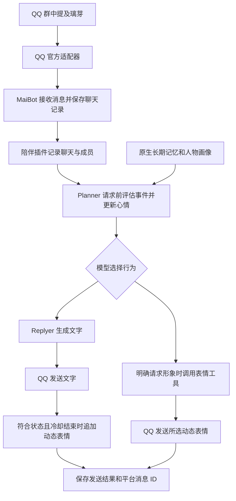

# 璃芽工作方式

MaiBot 负责聊天上下文、规划、回复和原生长期记忆；QQ 官方适配器负责平台收发；`local.liya-companion` 保存成员关系和持续心情，并把这些状态注入模型请求。大模型生成对话，状态插件保存可追踪的角色状态。

## 消息处理流程

## SDK 钩子分工

| 入口 | 工作 |
| --- | --- |
| chat.receive.after_process | 保存实际消息、成员和聊天标识，按消息 ID 去重 |
| maisaka.planner.before_request | 分类最新消息、持久化心情，注入原生 SystemMessageItem |
| maisaka.replyer.before_request | 与 Planner 共享评估锁和去重，将状态补入 extra_prompt |
| maisaka.reply.before_post_process | 关闭故意错字和回复切分，完整保留其他原生参数 |
| send_service.after_send | 仅在文字已成功发送后，按状态和冷却规则追加表情 |
| liya_expression 工具 | 用户明确要求看璃芽形象或表情时，发送指定 GIF |

工具调用可能不进入 Replyer，因此 1.0.1 将事件评估提前至 Planner。同一消息在规划重试和文字回复之间共享评估结果，避免重复改变心情。钩子的 modified_kwargs 会替换原生参数集合，因此必须同时保留未修改字段。

## 心情与关系

SQLite 按 `(session, user)` 保存状态，不把不同群、私聊或成员合并。`incoming` 保存去重后的最近消息，文本最多 800 字并清理 30 天前记录；`relations` 保存熟悉程度、信任、情绪和最后评估消息；`deliveries` 保存实际表情发送结果。

事件分类使用 `utils` 模型，返回 event 和 0到1的 intensity。事件到视觉状态的对应如下。

| 事件 | 视觉状态 |
| --- | --- |
| neutral | idle |
| praise | happy |
| success | excited |
| curiosity | curious |
| distress | caring |
| correction | thinking |
| greeting | greeting |
| goodnight | sleepy |
| teasing | sulky |
| boundary | caring |

情绪包含正负方向 valence 和活跃程度 arousal。旧状态向事件目标值平滑靠近，更新权重为 `0.2 + 0.35 × intensity`。正负方向限制在 -0.6到0.8，活跃程度限制在0.1到0.8。读取时按1.5小时半衰期回归基线；距最后评估达到3小时后，事件标签视为 neutral。衰减按时间计算，不依赖后台每分钟写数据库。

同一成员每60秒最多累计一次互动。互动次数小于8为初识，8到29为渐熟，30及以上为熟悉。信任初值0.5，目前仅在 correction 事件缓慢增加0.005，并限制在0.1到0.9；它不会因服从、刷夸奖或亲密措辞快速增长。情绪是角色状态模拟，不表示主观感受。

## 记忆分层

| 层次 | 保存内容 | 位置 |
| --- | --- | --- |
| 聊天上下文 | 实际消息与近期对话 | MaiBot 原生聊天数据 |
| 原生长期记忆 | 人物事实、摘要、画像及检索索引 | data/a-memorix/ |
| 陪伴状态 | 每个聊天内的成员关系、事件心情、发送记录 | data/plugins/local.liya-companion/companion.sqlite3 |

原生 A_Memorix 使用本机隔离的 Ollama bge-m3 生成1024维向量，模型服务地址为 `http://embeddings:11434/v1`。摘要和画像仍调用配置的大模型服务。自动摘要写回阈值为12；记忆提取和写回有处理时机，并非每条消息都立即形成一条长期事实。

已关闭全局记忆共享及群私聊跨聊天共享。长期记忆可在 WebUI 中查看、纠正和删除；陪伴状态独立保存在自己的 SQLite 数据库中，不等同于原生事实记忆。

## 表情规则

自动表情只响应已成功发送的文字，且当前消息明确提及机器人、状态不是 idle。每个聊天默认冷却1800秒；发送前标记消息，避免表情钩子递归。同一状态不意味着每次都发图。

`liya_expression` 接受九种 state，只在明确请求形象或表情时调用。工具每个聊天60秒内不重复发送；自动表情冷却也会参考已成功发送的手动表情。平台返回成功和消息 ID 后才记录成功发送。

## 管理状态

插件配置页的“陪伴状态”显示关系与发送计数；“验证情境分类模型”执行实际模型调用；“补处理最近未评估消息”处理最近一天各聊天最新的未评估消息，只更新状态，不主动向群里发消息。

分类错误不会被伪装成成功。排查时结合插件日志、原生模型调用结果和数据库状态定位问题，不用随机心情或编造记忆代替失败调用。
