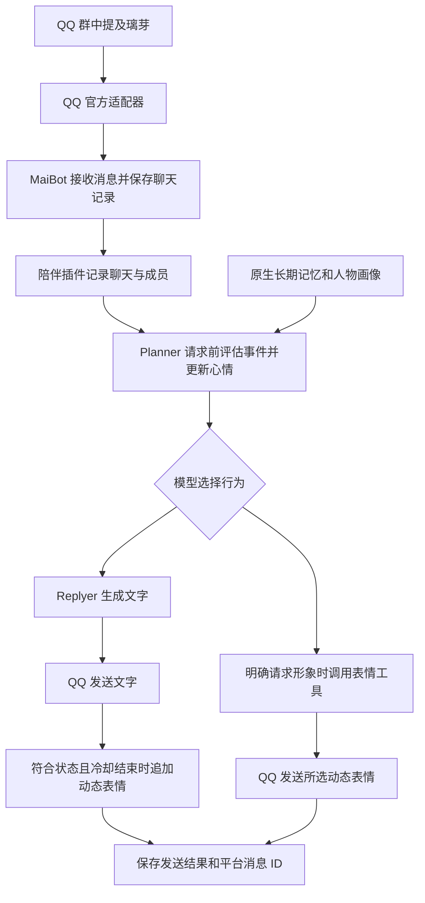

# 璃芽工作方式

1.5.0在下述机制上加入有来源的共同经历、回复前召回、结合记忆与上下文的情绪评估；普通接话不清空上一轮心情，删除与更正会同步处理索引和派生状态。当前行为以[共同经历与情绪记忆](12共同经历与情绪记忆.md)的补充规则为准。

MaiBot 负责聊天上下文、规划、回复和原生长期记忆；QQ 官方适配器负责平台收发；`local.liya-companion` 保存成员关系和持续心情，并把这些状态注入模型请求。大模型生成对话，状态插件保存可追踪的角色状态。

当前1.4.0增加 `conversation.sqlite3`，按聊天与真实用户标识保存引用、提及、个人偏好、停止边界、话题进展、操作回执、提醒和游戏。它与原生事实记忆及原有心情数据库分工独立。完整验收范围见[聊天能力目标与验收](09聊天能力目标与验收.md)。

## 消息处理流程

## SDK 钩子分工

| 入口 | 工作 |
| --- | --- |
| chat.receive.after_process | 保存实际消息、成员和聊天标识，按消息 ID 去重 |
| maisaka.planner.before_request | 分类最新消息、持久化心情，注入原生 SystemMessageItem |
| maisaka.replyer.before_request | 与 Planner 共享评估锁和去重，将状态补入 extra_prompt |
| maisaka.reply.before_post_process | 关闭故意错字和回复切分，完整保留其他原生参数 |
| send_service.before_send | 取消已停止请求的旧回复，并为每次请求保留一次正文发送机会 |
| send_service.after_send | 仅在文字已成功发送后，按状态和冷却规则追加表情 |
| liya_expression 工具 | 用户明确要求看璃芽形象或表情时，发送指定 GIF |

工具调用可能不进入 Replyer，因此 1.0.1 将事件评估提前至 Planner。同一消息在规划重试和文字回复之间共享评估结果，避免重复改变心情。钩子的 modified_kwargs 会替换原生参数集合，因此必须同时保留未修改字段。

## 私聊陪伴与表达完成

1.5.1私聊改为无引用的自然回应，按静默与语义等待整轮表达；连续补充重算等待，生成中的旧正文遇到新私聊消息会被拦截。平常少追问、允许自然收尾。具体规则和实测边界见[私聊陪伴方式](13私聊陪伴方式.md)。

## 完整回复一次发送

文字回复等待模型完整生成后，作为一条正文发送，不逐句发送。全局配置关闭 `response_post_process.enable_response_post_process` 和 `response_splitter.enable`，插件继续保留 `enable_splitter=False` 的钩子保护。关闭全局后处理还避免原生处理器删除中文括号内容或将超过其长度阈值的正文替换成默认短句，保留模型生成的段落和换行。表情图片仍按下文的独立规则发送。

2026年11月3日已备份并修改现网这两项配置，运行日志确认热重载完成。在现网 MaiBot 的独立进程中调用原生异步正文处理器，验证多句多段正文及超过原长度阈值的长正文均只产生一个文字段，内容、括号与换行完整保留；未向 QQ 发送测试消息。

## 归属、停止、个人记忆和活动

当前请求者与正文引用对象分别处理，不因Replyer改用引用对象而切换当前成员身份。不存在的目标消息不会回退到另一个人的最新消息。上下文保留实际作者、提及对象及可解析的QQ引用索引；未知引用明确标记未知。

明确对璃芽说“先别说了”会暂停当前成员的聊天并结束其未完成话题；发送前再次核对，生成中的旧回复也会被取消。其他成员仍可交谈，原成员提出新请求可恢复，已取消的旧回复不会复活。原生合批继续使用自然模式；本部署将提及上限由1秒调整为4秒，为连续补充留出时间，整批上限仍为8秒。

`liya_personal` 提供称呼、玩笑与建议偏好，以及本人在当前聊天中的事实查询、记住、更正和删除。工具来源固定为当前请求快照，Host再次读取真实原始消息确认身份；模型传入的聊天与用户标识不能覆盖Host上下文。更正或删除须唯一匹配，指代不明确先澄清。个人事实只接受本人明确要求保存的原话，成功回执后才确认。删除特定记忆不等于删除原始聊天记录或整段公共群聊摘要；混合多人、没有明确聊天归属的材料不会自动按个人请求整段删除。

原生人物画像的聊天调用已补上范围参数与证据筛选，不再将忽略聊天范围的全局画像直接注入群聊。话题使用open、resolved、dismissed保存进展，结束的话题不再主动提起。情境分类最多等待6秒，失败时沿用已有真实状态，不中断正常聊天；回复模型异常或空结果经同一正文发送入口简短说明，继续受停止和去重规则约束。

`liya_activity` 只在明确要求后建立提醒或开始猜谜、字词接龙。提醒按北京时间保存，可查询、取消并跨重启恢复。到时仅尝试一次QQ发送；已发送、失败和结果未确认分别记录，发送中重启不会自动重发。QQ群主动投递受权限和额度约束，尚未通过当前版本真实投递验收，不保证任意时刻可达。游戏按聊天隔离，只有发起者可结束整个活动。

## 心情与关系

SQLite 按 `(session, user)` 保存状态，不把不同群、私聊或成员合并。`incoming` 保存去重后的最近消息及当时昵称，新消息文本最多4000字并标记截断，心情分类仅使用前800字；清理30天前记录。`relations` 保存熟悉程度、信任、情绪和最后评估消息；`deliveries` 保存实际表情发送结果。

事件分类使用 `utils` 模型，返回 event 和 0到1的 intensity。事件到视觉状态的对应如下。

| 事件 | 视觉状态 |
| --- | --- |
| neutral | idle |
| praise | happy |
| success | excited |
| curiosity | curious |
| distress | caring |
| correction | thinking |
| greeting | greeting |
| goodnight | sleepy |
| teasing | sulky |
| boundary | caring |
| embarrassment | shy（害羞） |
| surprise | surprised（惊讶） |
| concern | worried（担心） |
| sadness | sad（低落） |
| relief | relieved（释然） |
| encouragement | determined（认真鼓劲） |

六个新增事件的代码保留，但对应表情草稿已停止，现网未安装这些素材。插件启动时按实际 GIF 筛选可用状态，分类不会启用缺少素材的事件，工具也会拒绝未安装表情。强度随1.5小时半衰期变淡，使用“轻微、自然、明显”影响语气。旧数据库通过增加字段升级，保留已有关系和去重记录。

情绪包含正负方向 valence 和活跃程度 arousal。旧状态向事件目标值平滑靠近，更新权重为 `0.2 + 0.35 × intensity`。正负方向限制在 -0.6到0.8，活跃程度限制在0.1到0.8。读取时按1.5小时半衰期回归基线；距最后评估达到3小时后，事件标签视为 neutral。衰减按时间计算，不依赖后台每分钟写数据库。

只累计明确提及机器人或私聊中的互动，同一成员每60秒最多累计一次，每个北京时间自然日最多6次。至少8次且跨2天为渐熟，至少30次且跨7天为熟悉，其余为初识；旧数据库的互动和关系仍保留，但不虚构历史跨日证据。信任初值0.5，目前仅在 correction 事件缓慢增加0.005，并限制在0.1到0.9；它不会因服从、刷夸奖或亲密措辞快速增长。情绪是角色状态模拟，不表示主观感受。

## 记忆分层

| 层次 | 保存内容 | 位置 |
| --- | --- | --- |
| 聊天上下文 | 实际消息与近期对话 | MaiBot 原生聊天数据 |
| 原生长期记忆 | 人物事实、摘要、画像及检索索引 | data/a-memorix/ |
| 陪伴状态 | 每个聊天内的成员关系、事件心情、发送记录 | data/plugins/local.liya-companion/companion.sqlite3 |

原生 A_Memorix 使用本机隔离的 Ollama bge-m3 生成1024维向量，模型服务地址为 `http://embeddings:11434/v1`。摘要和画像仍调用配置的大模型服务。自动摘要写回阈值为12；记忆提取和写回有处理时机，并非每条消息都立即形成一条长期事实。

已关闭全局记忆共享及群私聊跨聊天共享。长期记忆可在 WebUI 中查看、纠正和删除；陪伴状态独立保存在自己的 SQLite 数据库中，不等同于原生事实记忆。

## 表情规则

自动表情只响应已成功发送的文字，且当前消息明确提及机器人、状态不是 idle。每个聊天默认冷却1800秒；发送前标记消息，避免表情钩子递归。同一状态不意味着每次都发图。

现网 `liya_expression` 按实际素材接受九种 state，只在明确请求形象或表情时调用。工具每个聊天60秒内不重复发送；自动表情冷却也会参考已成功发送的手动表情。平台返回成功和消息 ID 后才记录成功发送。`expression_animation` 开关已部署，关闭时发送同状态 PNG；默认发送 GIF。PNG 从本次实际部署的 GIF 首帧导出，未采用已停止草稿的静态图。

## 管理状态

插件配置页的“陪伴状态”显示关系与发送计数；“验证情境分类模型”执行实际模型调用；“补处理最近未评估消息”处理最近一天各聊天最新的未评估消息，只更新状态，不主动向群里发消息。

分类错误不会被伪装成成功。排查时结合插件日志、原生模型调用结果和数据库状态定位问题，不用随机心情或编造记忆代替失败调用。
