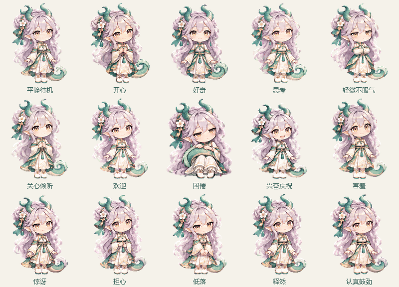

# 璃芽动画升级

> 历史方案：用户已改为原版圆润Q版画风及宠物逐帧动作条流程，本页不代表当前素材。最新交付见[原版逐帧表情](10原版逐帧表情.md)。
> 此页记录已停止的 v2 草稿。用户指出原动画素材有多余尾巴；该版未通过外观验收，不作为最终交付。当前改为只删除原 Q 版左侧多余尾巴，保留右侧尾巴原来的低位位置，并制作尾巴随动样片。

2026年11月3日本地完成。15种表情均为192×208透明 GIF，每种48帧、每帧50毫秒，即20 FPS、2.4秒循环。插件目录与设计目录的同名 GIF、PNG 字节一致。尚未替换服务器正在运行的1.0.1插件，也没有向 QQ 群发送测试图片。

## 预览与新增表情

打开 [preview.html](../assets/expressions/preview.html) 可逐个播放或暂停；系统开启减少动态效果时自动使用静态 PNG。



在原九种表情基础上，增加害羞、惊讶、担心、低落、释然、认真鼓劲。对应状态为 `shy`、`surprised`、`worried`、`sad`、`relieved`、`determined`，已接入情境分类和 `liya_expression` 工具。分类强度保存到数据库，并随时间变淡，提示词使用轻微、自然、明显等有界标签。

`expression_animation=true` 默认发送 GIF；设为 false 后，自动表情和明确请求的表情均使用同状态静态 PNG。自动表情30分钟冷却和明确请求60秒冷却保持原规则。

## 重复制作

图像生成工具提供关键姿势，Python 脚本只做提帧、对齐、补帧和动画编码。原九种关键姿势来自 `assets/expressions/liya-animation-atlas.png`，新增六种源图为 `assets/animation-sources/emotions-v2-keyframes.png`。两者均已保存在项目内。

```powershell
python -m venv .venv-artwork
./.venv-artwork/Scripts/python.exe -m pip install -r scripts/requirements-artwork.txt
./.venv-artwork/Scripts/python.exe scripts/build_animations.py
```

补帧使用双向 DIS 光流，先估计整体位移，再插入中间姿势；使用余弦缓入缓出和各状态独立的眨眼节奏，检查循环接缝。对无法匹配的眼睛、手指等细节采用较近关键姿势，减少双重轮廓。采用固定调色板，透明索引单独保留。输出通过临时文件替换，避免预览器正在读取素材时截断文件。

这是四个生成关键姿势加光流中间帧，存在局部形变的限制，不是48张独立绘制的动作。QQ 客户端可能调整 GIF 播放节奏，20 FPS 是文件中编码的帧率；目前没有做实际 QQ 播放观感验收。

## 验证范围

- 15个 GIF 解码后均为48个不同帧、50毫秒帧间隔、2.4秒循环，角色未接触画布边缘。
- 循环接缝的像素变化不超过普通帧间最大变化的1.5倍。
- 7项状态测试通过，覆盖新情绪、强度随时间变淡、持久化和旧数据库迁移。
- 在现网 MaiBot 1.3.19、SDK 2.20.0 的容器隔离副本中，10项表情及钩子契约测试通过。发送器和分类模型均为模拟对象；验证了素材读取、编码、发送调用、静态模式及冷却。
- 同一工作目录的群聊简报4项契约测试和14项单元测试同时通过，总计35项。没有更改运行中的插件或真实聊天数据库。

报告见[动画文件验证](../validation/animation-v2-validation.json)；情绪及钩子的隔离验证记录见[现有测试报告](../validation/briefing-validation.json)。源图、构建依赖、插件源码和素材均留在本地项目，服务器只放置了隔离测试副本。
