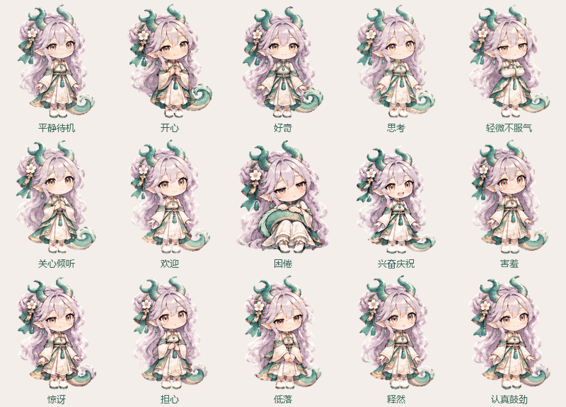

# 全部单尾表情动画

> 历史方案：用户已改为原版圆润Q版画风及宠物逐帧动作条流程，本页不代表当前素材。最新交付见[原版逐帧表情](10原版逐帧表情.md)。
本地15种情绪与表情使用统一的修正后Q版造型，保留原来的低位右尾，删除左侧多余尾巴。每种GIF为192×208像素、60帧、20 FPS、3秒循环，附同状态静态PNG。设计目录与插件素材目录的同名文件完全一致；服务器现网仍未同步。

## 预览



[逐个播放或暂停](../assets/expressions/preview.html)。系统开启“减少动态效果”时自动使用静态图。

| 状态 | 表情与动作 |
| --- | --- |
| idle | 平静待机，轻呼吸，尾尖缓慢摆动 |
| happy | 开心笑，轻轻晃身，尾巴欢快轻摆 |
| curious | 好奇歪头，尾尖轻抬 |
| thinking | 托腮思考，小幅缓慢摆尾 |
| sulky | 抱臂微微不服气，尾尖短幅摆动 |
| caring | 关心倾听，温柔点头，尾巴轻缓跟随 |
| greeting | 招手欢迎，尾巴同步摆动 |
| sleepy | 困倦垂眼，缓缓低头，尾巴放松轻摆 |
| excited | 兴奋庆祝，小幅跳起，尾尖延迟跟随回落 |
| shy | 害羞脸红，轻点头，尾尖含蓄轻摆 |
| surprised | 惊讶睁眼，小幅一惊后恢复，尾巴随动 |
| worried | 担心轻晃，尾巴低幅摆动 |
| sad | 安静低落，尾尖低垂轻摆 |
| relieved | 闭眼释然，放松呼吸，尾巴舒缓摆动 |
| determined | 认真鼓劲，轻点头，尾巴稳稳跟随 |

## 素材与重建

- `assets/single-tail-v3/*-reference.png`：图像生成工具按修正后的同一角色参考，为每种表情分别制作的源立绘。
- `assets/expressions/*.gif`、同名PNG：设计预览与交付素材。
- `src/liya_companion/assets/`：插件运行素材副本；15种独立GIF和三个合辑均同步替换。
- `liya-fifteen-states.gif`：五列三行、带中文标签的README合辑；九状态及新增六表情合辑也均为新版。
- `assets/animation-sources/previous-expression-set/`：替换前素材的归档，不供插件使用。

```powershell
./.venv-artwork/Scripts/python.exe -m pip install -r scripts/requirements-artwork.txt
./.venv-artwork/Scripts/python.exe scripts/build_single_tail_set.py
```

图像工具负责生成各自的表情和姿势；脚本沿尾长逐渐增加摆幅，固定被裙摆遮挡的原低位连接区域，并让尾尖带有跟随延迟。身体呼吸、轻晃、点头、招手和小跳按情绪分别设置。对同一立绘连续变形，避免在不同画作之间光流补帧导致重影或增加尾巴。面部表情由各自源立绘体现。

原 `build_animations.py` 的旧版整套构建已停用。`make_tail_sample.py` 是早期单个待机样片工具，整套重建应使用上面的命令，保持各状态的缩放、脚底基线和输出一致。

## 验证与记录

15种GIF逐一解码检查帧数、不同帧数、每帧50毫秒、循环接缝、透明边缘和尾巴区域的变化；同时核对两份插件/设计文件的字节一致性。单尾与低位外观通过源立绘和动作抽帧目视检查。报告见[完整素材验证](../validation/single-tail-v3-full-set-validation.json)。

生成使用内置图像工具；逐状态的完整提示词及源文件记录见[生成记录](../assets/single-tail-v3/generation-prompts.json)。这次替换不更改运行中的服务器、聊天数据库或发图冷却规则；QQ客户端的实际播放节奏需上线后在客户端验收。
