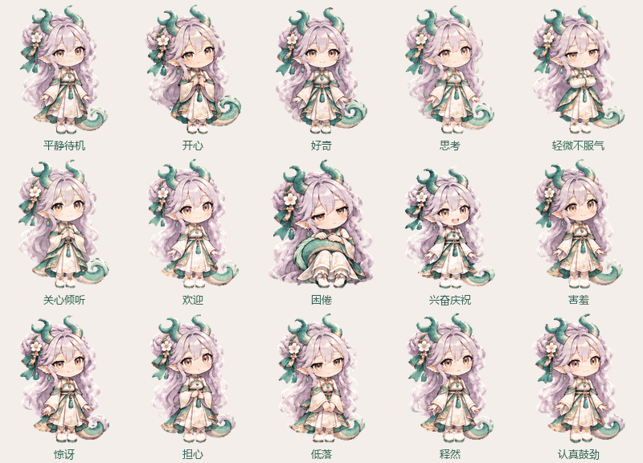

# 逐帧表情统一配色

2026年11月4日，本地15种表情以用户选择的原版抱尾图为唯一配色基准，修正偏粉、偏暖、偏暗和青绿色明度不一致的问题，保留原动作与造型。

此前每种状态独立生成，源图存在色温/明暗差异；GIF编码又对每一帧独立选择色表。现在保留抱尾基准本身，对另外14条动作条使用内置图像工具做仅颜色修正，再以从抱尾图提取的同一份色表编码整个图集、GIF和静态图。

统一的是基础材质与光照：银白淡紫头发、低饱和青绿龙角/龙尾/衣料、象牙白布料、柔和金边、自然肤色。表情需要的局部脸红和正常明暗层次保留。

## 预览

[逐个预览](../assets/expressions/preview.html) · [视频](../assets/expressions/liya-fifteen-states.mp4) · [校色前后示例](../assets/pet-style-v5-colors/color-progress-before-after.png)

## 记录与验证

- [源图、校色提示词与流程](../assets/pet-style-v5-colors/README.md)
- [固定色表及基准哈希](../assets/pet-style-v5-colors/shared-palette.json)
- [图集、GIF及素材验证](../validation/pet-style-v5-color-validation.json)
- [逐帧色表与透明轮廓审计](../validation/pet-style-v5-color-palette-audit.json)

配色验收覆盖 15 种表情的 120 张原画。当前导出的 GIF 包含原画与过渡帧，全部使用同一色表。静态 PNG 使用该色表中的颜色，插件素材和设计素材哈希一致。配色修正前的素材保存在 `assets/animation-sources/before-color-unification-v4/`。

重建使用 `scripts/requirements-pet-artwork.txt`、`scripts/qq_pet_frames.py` 和 `scripts/assemble_pet_style_set.py`。固定色表编码在 `scripts/shared_gif_palette.py`，相邻原画之间的过渡帧由 `scripts/pose_inbetweens.py` 生成。
